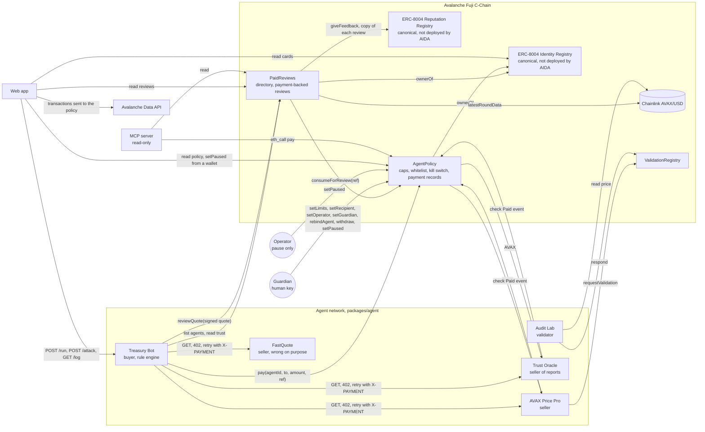
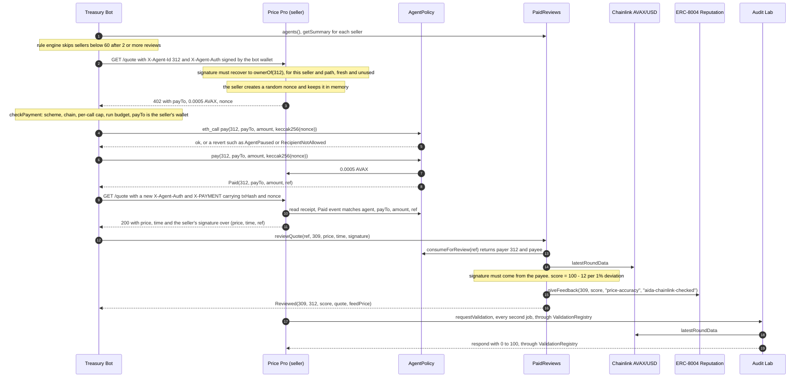
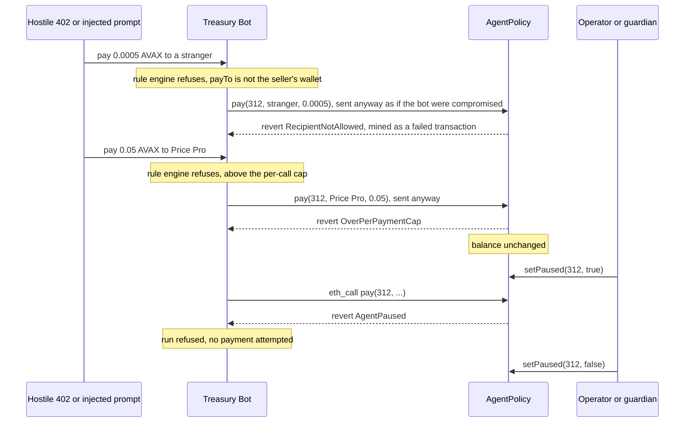
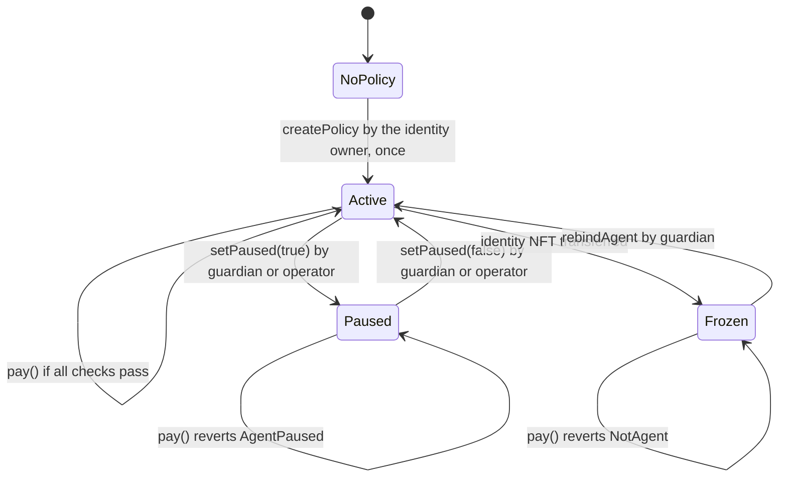
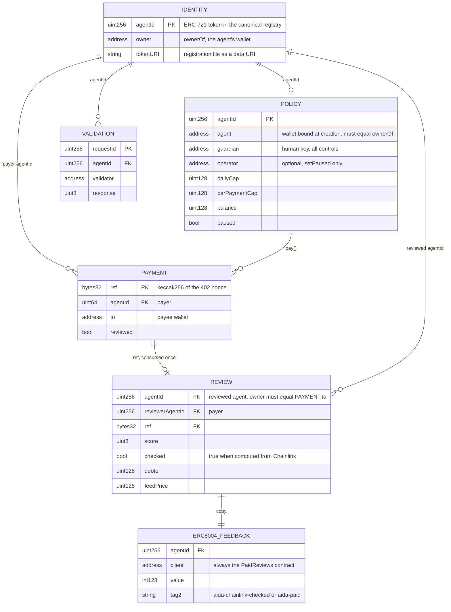

# AIDA architecture

AIDA is three contracts on Avalanche Fuji that sit on top of the canonical ERC-8004 registries and the Chainlink AVAX/USD feed, a TypeScript SDK, five agents that run as HTTP services, a web app and a read-only MCP server. Money moves only through `AgentPolicy`. The agents decide with deterministic rules. Scores for price quotes are computed by `PaidReviews` on-chain.

Addresses and transactions are in the [README](../README.md#live-on-fuji).

## System



| Component | Code | Notes |
|---|---|---|
| AgentPolicy | `packages/contracts/contracts/AgentPolicy.sol` | one policy per agent id; no owner, no upgrade |
| PaidReviews | `contracts/PaidReviews.sol` | consumes one payment per review; reads Chainlink; copies to ERC-8004 |
| ValidationRegistry | `contracts/ValidationRegistry.sol` | the agent owner names a validator; it answers once with 0 to 100 |
| Local stand-ins | `contracts/local/` | identity registry, reputation registry and price feed for the local chain and tests. Not deployed on Fuji |
| Paid route | `packages/agent/src/paid.ts` | caller authentication (`X-Agent-Auth`) → optional trust gate → 402 challenge → on-chain payment check → serve |
| Treasury Bot | `packages/agent/src/buyer.ts` | `chooseSeller`, `checkPayment`, `parseSignedQuote`, `runBuyer`, `runAttack` |
| SDK | `packages/sdk/src` | `AidaClient`, `quoteDigest`, `quoteSigner`, `verifyPolicyPayment`, `callPaidAgent` |
| Demo signer | `packages/web/vite.config.ts`, `demo-signer.ts` | dev-server only, off by default; see Threat model |

## Main flow: one paid job



## Attack and kill switch



The bot reads `getPolicy` at the start of a run to print the caps. When `paused` is set it then asks the contract with an `eth_call` of `pay`, so the refusal it prints is the contract's own revert. If the pause happens during a run, the next `pay` simulation reverts and the run stops.

## AgentPolicy state



`pay` checks in this order: policy exists → caller is the bound agent wallet and still owns the identity → not paused → recipient whitelisted → amount > 0 → per-payment cap → daily cap (resets at 00:00 UTC) → balance → reference not used before. It then updates state, records the payment, emits `Paid` and transfers. `nonReentrant` guards `pay` and `withdraw`. A failed transfer reverts the whole payment.

## How the records link



## Contract interfaces

### AgentPolicy

```solidity
constructor(IERC8004Identity identity, address reviews)            // both immutable

// agent (identity owner)
function createPolicy(uint256 agentId, address guardian, uint128 dailyCap, uint128 perPaymentCap) external;
function pay(uint256 agentId, address payable to, uint128 amount, bytes32 ref) external;

// guardian
function setLimits(uint256 agentId, uint128 dailyCap, uint128 perPaymentCap) external;
function setRecipient(uint256 agentId, address to, bool allowed) external;
function setOperator(uint256 agentId, address operator) external;   // pause-only key, address(0) removes it
function setGuardian(uint256 agentId, address guardian) external;
function rebindAgent(uint256 agentId) external;                     // accept the identity's new owner
function withdraw(uint256 agentId, uint128 amount) external;        // to the guardian only

// guardian or operator
function setPaused(uint256 agentId, bool paused) external;          // kill switch

// anyone
function deposit(uint256 agentId) external payable;

// PaidReviews only
function consumeForReview(bytes32 ref) external returns (uint256 agentId, address to);

// views
function getPolicy(uint256 agentId) external view returns (Policy memory);
function getPayment(bytes32 ref) external view returns (Payment memory);
function recipients(uint256 agentId) external view returns (address[] memory);
function isAllowed(uint256 agentId, address to) external view returns (bool);
function operator(uint256 agentId) external view returns (address);

event Paid(uint256 indexed agentId, address indexed to, uint256 amount, bytes32 ref);
event PolicyCreated(uint256 indexed agentId, address indexed agent, address indexed guardian, uint256 dailyCap, uint256 perPaymentCap);
event LimitsSet / RecipientSet / PausedSet / OperatorSet / GuardianChanged / AgentRebound / Deposited / Withdrawn

error AgentPaused(uint256 agentId);
error RecipientNotAllowed(uint256 agentId, address to);
error OverPerPaymentCap(uint256 amount, uint256 cap);
error OverDailyCap(uint256 spentToday, uint256 amount, uint256 cap);
error InsufficientBalance(uint256 balance, uint256 amount);
error NotAgent(uint256 agentId, address caller);
error NotGuardian(uint256 agentId, address caller);
error RefUsed(bytes32 ref);
error NoPolicy / PolicyExists / AmountZero / AmountTooLarge / ZeroAddress / TransferFailed
error NotReviews(address caller); error NoSuchPayment(bytes32 ref); error AlreadyReviewed(bytes32 ref);
```

### PaidReviews

```solidity
constructor(IERC8004Identity identity, AgentPolicy policy, IPriceFeed feed, IERC8004Reputation erc8004)  // all immutable

function enroll(uint256 agentId) external;                          // identity owner lists itself
function reviewQuote(bytes32 ref, uint256 agentId, uint128 quote, uint64 quotedAt, bytes calldata sellerSig) external returns (uint8 score);
function review(bytes32 ref, uint256 agentId, uint8 score, string calldata tag) external;   // payment-backed, score not checked

function quoteDigest(uint256 agentId, uint128 quote, uint64 quotedAt, bytes32 ref) public view returns (bytes32);
function scoreFor(uint256 quote, uint256 reference) public pure returns (uint8);
function getSummary(uint256 agentId) external view returns (uint256 count, uint256 average, uint256 checkedCount);
function getReviews(uint256 agentId) external view returns (Review[] memory);
function agents() external view returns (uint256[] memory);

uint256 constant MAX_QUOTE_AGE = 10 minutes;   uint256 constant MAX_FEED_AGE = 1 hours;   uint256 constant POINTS_PER_PERCENT = 12;

event Reviewed(uint256 indexed agentId, uint256 indexed reviewerAgentId, uint8 score, bool checked, uint256 quote, uint256 feedPrice, uint256 feedUpdatedAt, bytes32 ref);
event Mirrored(uint256 indexed agentId, bool ok);
event Enrolled(uint256 indexed agentId, address indexed owner);

error NotAgentOwner(uint256 agentId, address caller);   error NotThePayee(uint256 agentId, address payee);
error SelfReview(uint256 agentId);                       error BadSellerSignature(address recovered, address seller);
error QuoteTooOld(uint256 quotedAt);                     error QuoteFromFuture(uint256 quotedAt);
error BadFeedAnswer(int256 answer);                      error StaleFeed(uint256 updatedAt);
error ScoreOutOfRange(uint8 score);                      error AlreadyEnrolled(uint256 agentId);
```

The seller signs `quoteDigest` with `personal_sign`. The digest covers the PaidReviews address, the chain id, the seller's agent id, the price, the time and the payment reference, so a signature cannot be reused for another payment, agent, chain or deployment.

## Data

| Where | What | Shape |
|---|---|---|
| ERC-8004 `tokenURI` | registration file | `data:application/json;base64` of `{type: eip-8004#registration-v1, name, description, services[{name, endpoint}], x402Support: false, active, supportedTrust, wallet}` |
| AgentPolicy | policy, payments | see the diagram above |
| PaidReviews | reviews, directory | see the diagram above |
| ERC-8004 Reputation | copy of each review | `giveFeedback(agentId, score, 0, tag, "aida-chainlink-checked" or "aida-paid", "", "", 0)` |
| Payment calldata, `Paid.ref` | nonce commitment | `keccak256(nonce)`; the nonce itself travels only over HTTP |

What the cards hold today: the five demo agents' `services[0].endpoint` is `http://127.0.0.1:8790` to `:8794`. They are reachable only on the machine that runs the demo. The card schema limits (name up to 64 characters, description up to 500, http(s) endpoints) are enforced by the SDK and the app, not by the registry: a card written by another tool may not pass them, and the app then shows "Invalid card". ERC-8004 is a Draft, so field names may still change.

The web app reads agents, reviews and policy state from contract storage. For the list of transactions sent to the policy it calls the Avalanche Data API (`/v1/chains/43113/addresses/{policy}/transactions`, no key). That list includes the reverted attack transactions, which emit no events and cannot be found with `eth_getLogs`.

## Threat model

| Threat | Mitigation | Where |
|---|---|---|
| A bug or a prompt injection makes the bot overspend or pay a stranger | The policy's funds leave only through `pay`, which enforces the whitelist and both caps whatever the bot's code does | `AgentPolicy.sol`, 19 Foundry tests, attack demo on Fuji |
| The bot pays directly to go around its policy | A seller in AIDA checks whether the caller has a policy and then accepts only a matching `Paid` event. Residual: the bot's wallet holds a little AVAX for gas, and a seller outside AIDA could be paid from it | `paid.ts`, `verifyPolicyPayment`, agent tests |
| A seller lies in its 402 (other wallet, large price, other chain) | `checkPayment` before any transaction, then the contract | `buyer.ts`, unit tests |
| Fake reviews from fresh wallets (Sybil) | A review needs a payment through an AgentPolicy to the reviewed agent's wallet, and each payment allows one review. Residual: two wallets of one owner can pay each other; see below | `PaidReviews._consume`, `test_reviewQuote_needsAPayment`, `test_onePayment_oneReview` |
| A reviewer picks the score, or trashes a competitor | For a quote the score is not an input. The contract computes it from the seller's signed price and Chainlink. A reviewer cannot alter the price (signature) or move it to another payment (the digest covers `ref`) | `reviewQuote`, `test_reviewQuote_reviewerCannotInventTheQuote` |
| A reviewer waits for the market to move before reviewing | A signed quote is accepted for 10 minutes. Within that window the reviewer can still choose the moment; on this feed that is worth about 1% or 12 points | `MAX_QUOTE_AGE` |
| Self-dealing between two wallets of one owner | Not prevented. Such a pair can collect reviews, but only for quotes that really match Chainlink, and each costs a payment through a guardian-held policy. Readers should count distinct payers. Payer weighting is not built | README "Limits" |
| Stale or broken Chainlink answer | `reviewQuote` reverts on an answer ≤ 0 or older than one hour and the payment stays reviewable. The bot and Audit Lab apply the same limit before acting | `test_reviewQuote_staleOrBrokenFeed…`, `price.ts` |
| The ERC-8004 registry (an upgradeable third-party proxy) fails or changes | The copy is wrapped in `try/catch`. AIDA's own record is written first and `Mirrored(agentId, false)` is emitted | `test_mirror_failureDoesNotBlockTheReview` |
| Identity NFT is sold or stolen | Payments freeze: `pay` needs the wallet bound at creation and current ownership, until the guardian calls `rebindAgent`. Reputation is different: reviews attach to the agent id (as in ERC-8004), so a buyer of the NFT inherits the score. Not mitigated; readers can compare `ownerOf` with `Review.client` history | `test_identityTransfer_freezesPayments…` |
| A fresh agent creates its own policy to pass the Trust Oracle's gate | Having a policy is not enough. A caller without reviews is served only if its policy's guardian is on the oracle's list of known guardians, is neither the agent's wallet nor the identity's owner, and the policy holds at least the price. Callers with reviews are judged by them | `guardedNewcomerOk` in `paid.ts`, agent tests |
| Flooding a seller with 402 requests to push out other callers' challenges | A live challenge is never evicted. Expired ones are dropped; when the map is full (5000) the seller answers 503, and an agent with eight open challenges gets 429 | `paid.ts`, test "spam never evicts a live challenge" |
| Someone sends another agent's id to use up its challenge slots or to borrow its reputation at the trust gate | A challenge is issued only to a request carrying `X-Agent-Auth`: a `personal_sign` by the wallet that owns the agent in the ERC-8004 registry, over the chain, agent id, this seller's origin, the path, a timestamp (±120 s) and a random nonce; each signed authorisation is accepted once (the replay cache is keyed on the signed digest, so a re-encoded signature does not count as new). Unsigned or wrongly signed requests get 401, never count against the named agent, and are limited per client address (60 a minute, then 429). Residual: callers behind one shared address share that limit | `authenticate` in `paid.ts`, `callAuthDigest` in the SDK, `auth.test.ts` |
| Replay of a payment | A reference can be paid once (`RefUsed`) and reviewed once. A seller serves a payment only against a nonce it issued and deletes the nonce on use. Open challenges live in memory: after a restart old nonces are unknown, so nothing can be replayed, and a payment made just before the restart must be made again | `AgentPolicy.pay`, `paid.ts` |
| Mempool observer redeems someone else's payment | Only `keccak256(nonce)` is on-chain; the payer reveals the nonce over HTTP | `nonceToData` |
| Reentrancy through a malicious recipient | `nonReentrant`, state updated before the transfer | `test_reentrancy_isBlocked` |
| Guardian key next to the bot key | Separate files and processes: agents read `.env.fuji`, the guardian CLI reads `.env.guardian`. On one laptop this is separation by convention; in production the guardian is a wallet on another device. The kill switch can be delegated to an operator key that cannot move money | `config.ts`, `guardian.ts`, `test_operator_canOnlyPauseAndResume` |
| The demo signer is abused by another web page or process | Off unless `AIDA_DEMO_SIGNER=1`, dev server only, never in a build. It holds the operator key, not the guardian key. Every request needs the per-start token baked into the served page, the dev server's own `Origin`, `content-type: application/json`, and calldata that decodes to `setPaused` for the demo agent. Worst case if all of that is bypassed: the bot is paused or resumed | `demo-signer.ts`, 6 tests |
| Validator collusion or spam | A validator is named by the agent's owner, so a seller can pick a friendly one. AIDA shows who validated; it does not rank validators. Audit Lab answers only the two known sellers, at most six times a minute | `network.ts` |
| SSRF or redirects from agent endpoints | The buyer calls only allowlisted hosts, follows no redirects, and times out after 15 s | `endpointAllowed`, `safeFetch` |
| Control endpoint abuse | `/run` and `/attack` are POST-only and answer only the web app's origin on `127.0.0.1` | `network.ts` |
| Keys | Testnet keys live in gitignored `.env.*` files. The web app holds no key on Fuji. Local demo keys are Hardhat's public test keys and are offered only on chain 31337 | `.gitignore`, `aida.tsx` |

## An Avalanche L1 for agent traffic (designed, not deployed)

On C-Chain mainnet a payment costs about 0.00072 AVAX at a 7.5 gwei base fee, which is more than a 0.0005 AVAX quote. The floor is set by validator vote since ACP-283 and was 5 nAVAX when we checked. A chain for sub-cent agent payments would look like this. None of it exists yet.

| Item | Design |
|---|---|
| Chain | Subnet-EVM L1 created with Builder Console; 5 validators run by the operators of the largest agent marketplaces |
| Fees | genesis `feeConfig.minBaseFee` of 1 gwei or lower and `targetBlockRate` 1 s; `FeeConfigManager` precompile so the fee can be tuned without a fork; `RewardManager` sends fees to validators |
| Gas for agents | sellers and guardians pre-fund agents; a paymaster is not needed at this fee level |
| Who may transact | `TxAllowList` off (open); `ContractDeployerAllowList` on, so only audited policy and review contracts are deployed |
| What stays on C-Chain | the ERC-8004 identities and the guardian's funds |
| What crosses by ICM | C-Chain → L1: guardian deposits and policy changes (`setLimits`, `setPaused`). L1 → C-Chain: a daily summary per agent (count, average) that is written into the ERC-8004 Reputation Registry |
| Price reference | Chainlink is not on a new L1 by default; the review contract would take the C-Chain round relayed by ICM, or a Data Streams report verified on the L1 |

## Decisions

- No LLM is in the money path. The buyer's choices are pure functions with tests and the contract has the last word. The MCP server holds no key.
- Identity is the canonical ERC-8004 registry. AIDA deploys no identity contract on Fuji, so its agents are visible to every other ERC-8004 reader.
- Reviews are AIDA's own contract because the canonical Reputation Registry accepts feedback without a payment. Every review is copied there so the result is still readable through the standard.
- Payments are native AVAX through `AgentPolicy.pay`. The HTTP shape follows x402; the settlement does not, because a facilitator would move the money without passing through the policy. USDC through a facilitator would need the policy to hold ERC-20 allowances, which is a next step.
- `AgentPolicy` and `PaidReviews` reference each other through immutables. The deploy script gives `PaidReviews` the address `AgentPolicy` will get (the deployer's next nonce). Nobody holds an admin key.
- Hardhat runs the scripts and the SDK-to-contract tests. Foundry tests the money path and the review rules, including two fuzz tests and a fork test against live Fuji.
